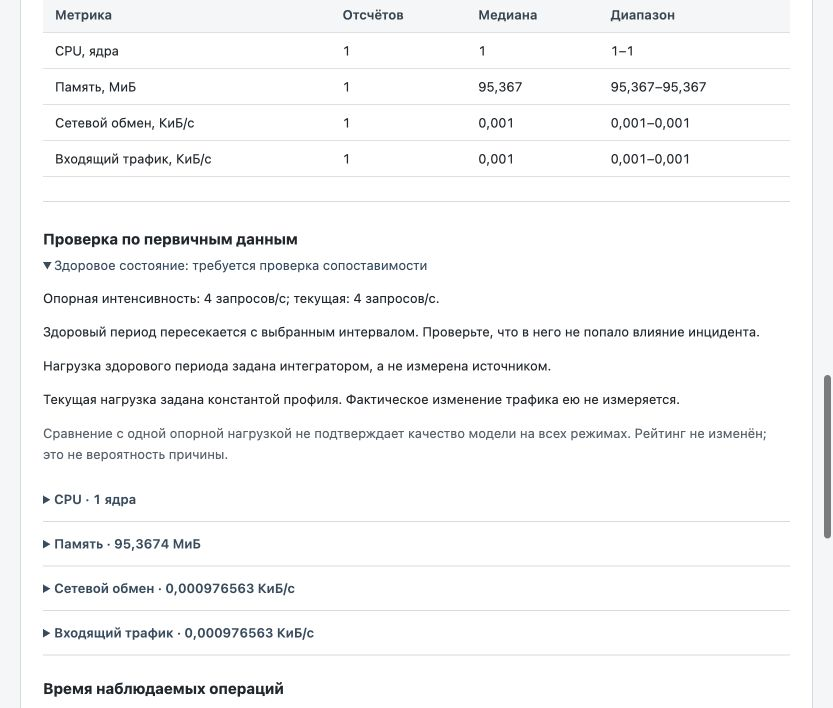

# Проверка итерации 2 — 19.10.2026

Продуктовая ветка `codex/research-iteration-2`, изменение `a1b84c8`.
Включено в main `2b4349b` через [PR #1](https://github.com/keytash1/rca-workbench/pull/1).
Новая оценка baseline — рабочая надстройка, не новая модель.

## Результат

138 продуктовых Python-тестов, 12 Node-проверок, 7 проверок отдельного контекста
успешны. OpenAPI валиден. Смысл: прежние запросы/карточки/помощник не сломаны;
метаданные baseline объясняются единообразно; прототип ограничивает доступ,
время и объём и явно отличает отсутствие ответа от пустой выборки.

Чистый экспорт вне checkout: 129 файлов (1.5 MiB), все SHA-256 проверены,
14 модельных артефактов совпали. В нём прошли 8 целевых проверок HTTP-пути,
подготовки профиля и применимости baseline. Корпус, DOCX и приватное хранилище
в состав не вошли. Manifest экспортного среза:
`6a11382e0af83d0a113e2d9744242158bac545249d83a8ebd2dba37c6245b160`.
Это квитанция фактических байтов до коммита; её `origin_commit` — исходный
`96d0ceb`, а `worktree_bytes_are_authoritative=true`, не ложная привязка новых
байтов к старому дереву Git.

## Браузер

Отдельный временный сервер, искусственный профиль с двумя сервисами и
локальный HTTP-имитатор телеметрии. Проверены выбор системы/интервала,
полный рейтинг, исходные наблюдения и автоматически раскрытое предупреждение
о пересечении baseline. `fixed_rps` ясно назван константой, не измерением.
Сервер предпросмотра после проверки остановлен; рабочая установка пользователя
не перезапускалась и её настройки не менялись.

## Что этим не доказано

Не новый опыт точности, не подтверждение пользы LLM, не настоящее подключение
Loki и не эксплуатация у нескольких команд. Для Loki проверены только
искусственные контрактные случаи. Участие инженера и истинность гипотез
не заменяются количеством зелёных тестов. Новых LLM-вызовов и запусков Docker
в этом проходе не было. Отчёт ВКР не редактировался.

## Удалённая контейнерная проверка

[CI commit](https://github.com/keytash1/rca-workbench/actions/runs/39180786314)
и [CI PR](https://github.com/keytash1/rca-workbench/actions/runs/39180871039)
успешны. Сборка Docker target assistant, offline composition и private volume
между независимыми non-root контейнерами прошли. Локальный Docker не запускался.
